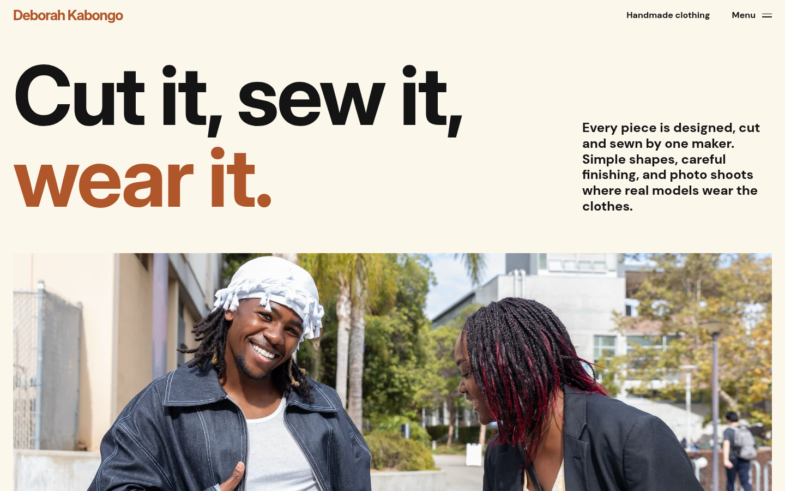
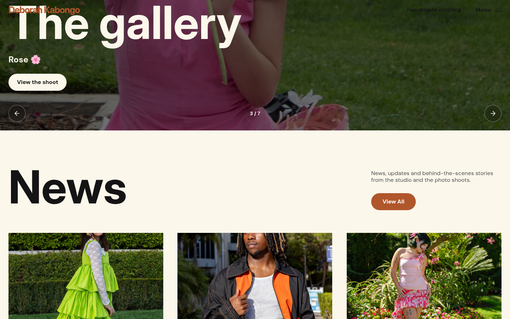
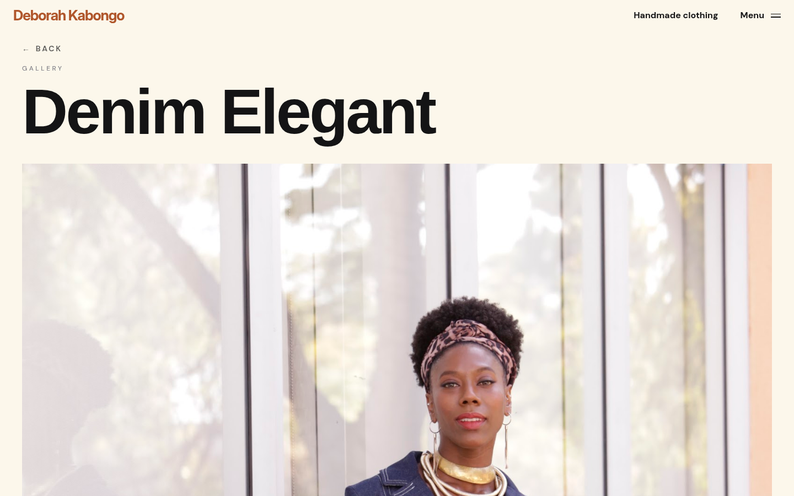

# DK-Shop

> Portfolio website for **Deborah Kabongo**, a clothing designer and maker.

**Live site:** [dkshop-omega.vercel.app](https://dkshop-omega.vercel.app)

## About

DK-Shop presents Deborah's handmade clothing: "Cut it, sew it, wear it." The site is an immersive, award-site-style portfolio - oversized type, full-screen photography, a scroll-driven gallery - built around her collections and photo shoots.

This is a real client project, not a concept: Deborah updates the site herself by adding photos to shared albums, with no code change or redeploy needed.

## Features

- **Immersive landing page** - hero, maker intro, "Behind the seams" categories (Dresses, Jackets, Pants) and news highlights
- **Scroll-driven gallery carousel** ("The gallery") - a photo strip that expands to full screen as you scroll, then loops endlessly in both directions
- **Live photo albums** - the photography loads from shared Google Photos albums through a serverless endpoint (`/api/albums`); the share links stay server-side, responses are cached, and the site falls back to bundled photos if the endpoint fails
- **Album-driven page slots** - albums named Hero, Dresses, Jackets and Pants fill the homepage photo and the "Behind the seams" categories
- **Gallery pages** - one page per album (`/gallery/:id`) with a swipeable lightbox viewer
- **News** - a news list and full article pages (`/news`, `/news/:slug`)
- **Motion details** - Framer Motion animations, a custom cursor and a full-screen menu overlay
- **Responsive** - layouts tuned for mobile and desktop, with carousel crops that keep the garments in frame

## Screenshots

| Home | Gallery carousel |
| --- | --- |
|  |  |

| Gallery page |
| --- |
|  |

## Tech Stack

- **React 18 + TypeScript + Vite** (SWC)
- **React Router 7** - landing, gallery and news routes
- **Tailwind CSS + shadcn/ui (Radix UI)**, with SCSS for global styles
- **Framer Motion** - animations and the scroll-driven carousel
- **lucide-react** icons
- **Vercel serverless functions** (`@vercel/node`) - the `/api/albums` photo endpoint
- Inter Display for titles, DM Sans for body text

## Getting Started

```bash
git clone https://github.com/Kbelony/DK-Shop.git
cd DK-Shop
npm install
npm run dev
```

Then open http://localhost:5173.

The site works out of the box with its bundled photos. To serve live albums, set the `ALBUM_SHARE_URLS` environment variable (server-side only, see `api/albums.ts`) on your Vercel project. Albums named Hero, Dresses, Jackets and Pants fill the matching page slots; the other albums become carousel slides and gallery pages.

## Project Structure

```
api/albums.ts            # serverless endpoint that reads the shared photo albums
src/
├── components/landing/  # hero, sections, navbar, footer, cursor
├── components/gallery/  # album pages + lightbox
├── components/news/     # news list + article pages
├── components/ui/       # shadcn/ui primitives
├── data/                # static fallback galleries + news content
├── hooks/               # useGallery data hook
├── services/            # photo album client (googlePhotos.ts)
└── assets/scss/         # global styles
```
